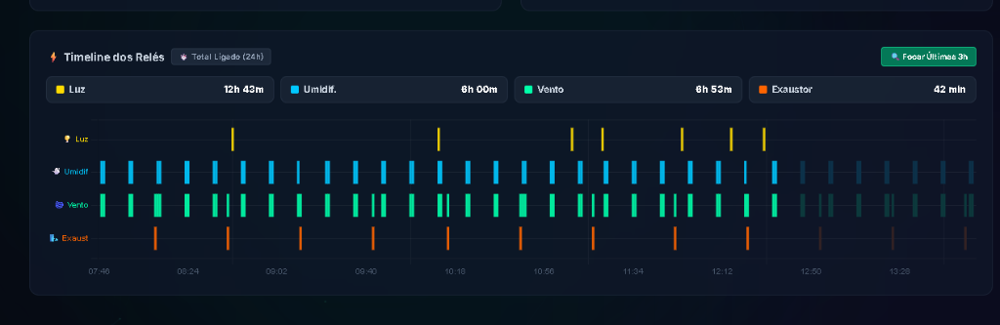
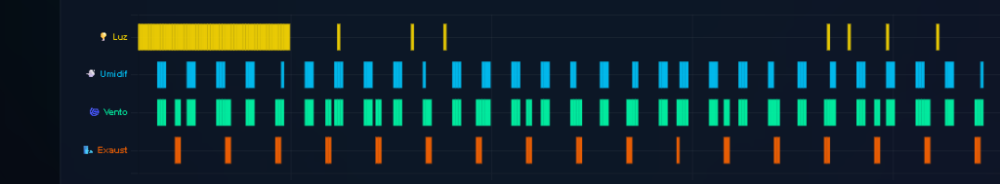

# 🍄 Grow do Txai — Sistema Inteligente de Automação IoT (v1.6.5 / FW v446 Oficial)

[-gold?style=for-the-badge&logo=target)](https://github.com/gabrielweb7/MyNiceGrow)
[](https://www.espressif.com/)
[](https://www.arduino.cc/)
[](https://www.freertos.org/)
[](https://www.php.net/)
[](https://www.mysql.com/)
[](https://github.com/)

Um ecossistema IoT autônomo, robusto e de nível profissional projetado especificamente para **micologia de precisão e controle ambiental de cultivo protegido** (especialmente fungos como *Psilocybe cubensis*, shimeji, cogumelos medicinais e comestíveis).

O sistema suporta tanto a arquitetura **ESP32-C3 (RISC-V 32-bit - placa ativa padrão)** quanto **ESP32-S3 (Xtensa Dual-Core)**, leitura com sensor industrial de precisão **SHT30 via I2C**, sensor de referência externa **DHT11**, controle de **5 relés atuadores** (Iluminação, Umidificador, Vento Interno, Exaustor FAE e Ar Condicionado HVAC com proteção de compressor), memória não-volátil anti-apagão (NVS Flash), datalogger offline em LittleFS, máquina de estados não-bloqueante, atualização remota **Over-The-Air (OTA) Dual-Bank com auto-recuperação (Anti-Brick)** e um **Dashboard Web SPA em tempo real**.

---

## 🏛️ Guia Definitivo para Desenvolvedores & Futuras IAs

> [!IMPORTANT]
> **LEIA ANTES DE MODIFICAR QUALQUER LINHA DE CÓDIGO:**  
> A placa instalada fisicamente na estufa em produção é um **ESP32-C3** (RISC-V).  
> Nunca envie um binário compilado para ESP32-S3 (Xtensa) para a rota da C3, pois a arquitetura do processador é diferente e a placa recusará a gravação!

### 1. Arquitetura de Memória e Dual-Bank OTA
* **Partições:** O chip utiliza a tabela de partição `min_spiffs` (Minimal SPIFFS com 1.9MB para cada gaveta OTA: `ota_0` e `ota_1`, e 128KB de SPIFFS).
* **Mecanismo Anti-Brick (`esp_ota_ops.h`):**
  1. A nova versão grava na gaveta secundária e a placa reinicia.
  2. Ao ligar, o firmware novo entra em modo de validação pendente.
  3. Se ele conseguir conectar ao Wi-Fi e receber `HTTP 200 OK` do backend na nuvem, ele executa `esp_ota_mark_app_valid_cancel_rollback()`, consolidando a versão como estável.
  4. Se o novo firmware der crash (Kernel Panic), travar no loop (Watchdog) ou não responder à nuvem em 5 minutos, o microcontrolador aciona automaticamente o rollback de hardware e reinicia na versão estável anterior sem intervenção humana.
* **Rollback Remoto por Botão:** O painel conta com um botão que envia o comando `{ "rollback": 1 }`. Ao receber a ordem, a placa chama `Update.rollBack()` e reverte para a partição estável em ~30 segundos.

---

### 2. Como Compilar para ESP32-C3 via Linha de Comando (CLI)
Para gerar o binário de produção de forma rápida e precisa sem depender de cliques manuais:

```powershell
& "C:\Users\ghost\AppData\Local\Programs\Arduino IDE\resources\app\lib\backend\resources\arduino-cli.exe" compile `
  --fqbn esp32:esp32:esp32c3:PartitionScheme=min_spiffs `
  --output-dir "build/esp32.esp32.esp32c3" `
  "esp32c3"
```

### 3. Como Fazer o Deploy de uma Nova Versão OTA
1. Incremente a versão em `esp32c3.ino` (ex: `#define FW_VERSION 442`) e sincronize a cópia em `esp32c3/esp32c3.ino`.
2. Execute o comando de compilação acima.
3. Copie o binário gerado:
   - De: `build/esp32.esp32.esp32c3/esp32c3.ino.bin`
   - Para: `grow.alquimistasmagicos.com.br/build/esp32.esp32.esp32c3/esp32c3.ino.bin`
   - E salve uma cópia versionada em: `grow.alquimistasmagicos.com.br/build/versoes/v442_esp32c3.bin`
4. Atualize a versão nos arquivos `build/version.json` e `grow.alquimistasmagicos.com.br/build/version.json` (`"versao": "v442"`), que o backend `api/fw.php` lê automaticamente.
5. Faça o commit e push para o GitHub:
   ```bash
   git add -A
   git commit -m "feat: release firmware v442"
   git push origin main
   ```
6. No cPanel da HostGator (Git Version Control), acione o **"Update from Remote"**.
7. No Dashboard Web, vá na aba **Firmware & OTA** e clique em **"⚡ Instalar Versão da Nuvem na Placa"**!

---

## 🔌 Diagrama de Conexões & Pinagem (Wiring & Pinout)

| Componente | Função | Pino ESP32-C3 (Produção) | Pino ESP32-S3 | Nível Lógico |
| :--- | :--- | :---: | :---: | :--- |
| **SHT30 (Interno)** | Clock I2C (SCL) | **GPIO 5** | GPIO 5 | 3.3V (Pull-up interno) |
| **SHT30 (Interno)** | Dados I2C (SDA) | **GPIO 4** | GPIO 4 | 3.3V (`0x44`) |
| **DHT11 (Ambiente)** | Referência Externa | **GPIO 10** | GPIO 10 | 3.3V (Pull-up 10k) |
| **Relé 1 (Luz)** | Fotoperíodo do Cultivo | **GPIO 0** | GPIO 0 | `LOW` = Ligado |
| **Relé 2 (Umidificador)** | Névoa Ultrassônica | **GPIO 1** | GPIO 1 | `LOW` = Ligado |
| **Relé 3 (Vento Interno)** | Brisa / Circulação | **GPIO 3** | GPIO 3 | `LOW` = Ligado |
| **Relé 4 (Exaustor)** | Troca de Ar (FAE) | **GPIO 6** | GPIO 6 | `LOW` = Ligado |
| **Relé 5 (Ar Condicionado)** | Climatização HVAC | **GPIO 7** | GPIO 7 | `LOW` = Ligado *(Anti-Ciclo Curto de 3 min)* |
| **Botão Físico (BOOT)** | Factory Reset (5s) | **GPIO 9** | GPIO 0 | Pull-up Interno |

---

## ❄️ Lógica Térmica do Ar Condicionado (HVAC) & Sifão Pós-AC
* **Partida Automática:** Aciona quando `tempInt >= pf.tempMax` (ex: `29°C` na Pinagem ou `28°C` na Frutificação).
* **Pós-Resfriamento de Fixação (`tPosMeta`):** Ao atingir a meta (`tempInt < pf.tempMax`), mantém o ar ligado pelo tempo configurado no painel (padrão **5 minutos**) para estabilizar a temperatura antes de desligar.
* **Sifão Térmico em Ondas Pós-AC (`v444`):** Durante o AC e após o desligamento pela janela configurável (`tSifaoPosAc`, padrão `15 min`), enquanto a sala estiver mais fria (`tDeltaExt`, padrão `0.4°C`, com histerese de saída `tDeltaSaida`, padrão `0.1°C`, e piso mínimo `tSifaoTempMin`, padrão `22.0°C`), o exaustor suga o ar frio acumulado em ondas: ao atingir o piso de umidade (`uGuardaCorte`, padrão `90.0%`), pausa o Sifão e força reidratação rápida até recuperar a **Umidade Alvo da fase** (`uRetornoAlvo = 1`, ou `%` manual em `uGuardaRetorno`), repetindo novas ondas enquanto houver frio disponível.
* **Proteção Anti-Ciclo Curto do Compressor:** O compressor respeita repouso mínimo obrigatório de **3 minutos** entre desligamento e religamento — **inclusive após reinicializações (`bootTime`)** — e mínimo de **1 minuto** ligado.
* **Trava Anti-Congelamento (`tCongela`):** Desliga imediatamente se `tempInt <= tCongela` (configurável no painel; padrão 15.0°C).
* **Pausa de Segurança (`tMaxRun`):** Descanso preventivo de 10 min se operar continuamente além do limite configurado (padrão 45 min; configurável no painel).

---

## 🧙‍♂️ Créditos & Licença
Desenvolvido por **Gabriel da Luz** ([@gabrielweb7](https://github.com/gabrielweb7)) para o **Grow do Txai** por **Alquimistas Mágicos**.  
Distribuído sob licença **MIT**. Sinta-se livre para usar, estudar e evoluir a automação micológica! 🍄✨

---

## 📸 Demonstração do Ecossistema


*Figura 1: Dashboard SPA em tempo real com telemetria, controles remotos e gráficos sincronizados de umidade, temperatura e relés.*


*Figura 2: Timeline dos 4 relés em trilhas horizontais independentes (swimlanes) e projeção preditiva (3 horas à frente).*

---

## 📑 Sumário

- [Visão Geral & Arquitetura do Sistema](#-visão-geral--arquitetura-do-sistema)
- [Diagrama de Conexões & Pinagem (Wiring & Pinout)](#-diagrama-de-conexões--pinagem-wiring--pinout)
- [Cérebro Climático & Fases de Cultivo](#-cérebro-climático--fases-de-cultivo)
- [Engenharia de Resiliência & Blindagem contra Falhas](#-engenharia-de-resiliência--blindagem-contra-falhas)
- [Dashboard Web & Projeção Futura (Ghost Chart)](#-dashboard-web--projeção-futura-ghost-chart)
- [Pipeline de Auto-Atualização Contínua (Auto-OTA)](#-pipeline-de-auto-atualização-contínua-auto-ota)
- [Estrutura de Arquivos do Repositório](#-estrutura-de-arquivos-do-repositório)
- [Guia de Compilação & Exportação](#-guia-de-compilação--exportação)
- [Diretrizes para Desenvolvedores & Futuras IAs](#-diretrizes-para-desenvolvedores--futuras-ias)

---

## 🏛️ Visão Geral & Arquitetura do Sistema

O ecossistema opera em uma **topologia híbrida e resiliente**: a placa ESP32-S3 (ou ESP32-C3) tem **100% de autonomia local** (toma decisões a cada 2 segundos mesmo que fique sem internet por meses), enquanto a nuvem na HostGator gerencia persistência histórica, dashboard gráfico e entrega de comandos remotos.

```
┌────────────────────────────────────────────────────────────────────────┐
│                   ESP32-S3 DUAL USB-C (XTENSA DUAL-CORE)               │
│                                                                        │
│   [ Sensor SHT30 (I2C) ] ──┐                                           │
│   [ Sensor DHT11 (GPIO10)] ┼─► [ Loop Não-Bloqueante (millis) ]        │
│   [ LED RGB Integrado ]    │   [ NVS - Memória Flash Permanente ]      │
│   [ Dual USB-C Native/UART]│   [ LittleFS Datalogger Offline (512B) ]  │
│                            │   [ FreeRTOS Cão de Guarda (25s) ]        │
│                            │                 │                         │
│                            │                 ▼                         │
│                            │      [ Módulo 4 Relés + Relé AC ]        │
│                            │        ├── Ch 1 (GPIO 0): Iluminação      │
│                            │        ├── Ch 2 (GPIO 1): Umidificador    │
│                            │        ├── Ch 3 (GPIO 3): Ventilador Int. │
│                            │        ├── Ch 4 (GPIO 6): Exaustor Ext.   │
│                            │        └── Ch 5 (GPIO 7): Ar Condicionado │
└────────────────────────────┼───────────────────────────────────────────┘
                             │ HTTPS / TLS (POST Telemetria a cada 4s)
                             ▼
┌────────────────────────────────────────────────────────────────────────┐
│                   NUVEM / BACKEND (HOSTGATOR CPANEL)                   │
│                                                                        │
│   [ API REST PHP 8.x ] ◄──► [ Banco MySQL (`telemetria`) ]             │
│   [ Servidor de OTA ]  ◄──► [ Binário `build/.../esp32c3.ino.bin` ]    │
└────────────────────────────┬───────────────────────────────────────────┘
                             │ JSON / Polling Dinâmico
                             ▼
┌────────────────────────────────────────────────────────────────────────┐
│                   DASHBOARD WEB (SPA RESPONSIVO)                       │
│                                                                        │
│   • Gráficos Chart.js 4.4 Sincronizados (Umidade, Temp, Timeline Relés)│
│   • Projeção Futura de 3 Horas (Ghost Bars sem barcode effect)         │
│   • Controle Remoto Imediato de Luz, Fases, Alertas e Configurações    │
│   • Horímetro de Manutenção Preventiva em Horas Reais de Operação      │
└────────────────────────────────────────────────────────────────────────┘
```

---

## 🔌 Diagrama de Conexões & Pinagem (Wiring & Pinout)

### Tabela de Pinagem Oficial (ESP32-S3 Dual USB-C & ESP32-C3)

| Componente | Função | Pino ESP32-S3 | Pino ESP32-C3 | Nível Lógico / Tensão | Protocolo |
| :--- | :--- | :---: | :---: | :---: | :--- |
| **SHT30 (Interno)** | Linha de Clock (SCL) | **GPIO 5** | **GPIO 5** | 3.3V (Pull-up interno) | I2C (Fio Amarelo) |
| **SHT30 (Interno)** | Linha de Dados (SDA) | **GPIO 4** | **GPIO 4** | 3.3V (Pull-up interno) | I2C (Fio Verde `0x44`) |
| **DHT11 (Ambiente/Sala)** | Leitura de Referência Externa | **GPIO 10** | **GPIO 10** | 3.3V (Resistor pull-up) | One-Wire Digital |
| **Relé 1 (Luz)** | Iluminação do Cultivo (12/12) | **GPIO 0** | **GPIO 0** | Nível Baixo Ativo (`LOW`=Liga) | Digital Output *(Protegido)* |
| **Relé 2 (Umidificador)** | Névoa Ultrassônica | **GPIO 1** | **GPIO 1** | Nível Baixo Ativo (`LOW`=Liga) | Digital Output |
| **Relé 3 (Vento Interno)** | Circulação Interna / Brisa | **GPIO 3** | **GPIO 3** | Nível Baixo Ativo (`LOW`=Liga) | Digital Output |
| **Relé 4 (Exaustor)** | Troca de Ar (FAE / Injeção Fria) | **GPIO 6** | **GPIO 6** | Nível Baixo Ativo (`LOW`=Liga) | Digital Output |
| **Relé 5 (Ar Condicionado)** | Refrigeração HVAC (Anti-Ciclo Curto) | **GPIO 7** | **GPIO 7** | Nível Alto Ativo (`HIGH`=Liga) | Digital Output *(Ativo)* |
| **Relé 6 (Vento Externo)** | Convecção Térmica da Sala | **GPIO 8** *(Reserv.)* | **GPIO 8** | Nível Baixo Ativo (`LOW`=Liga) | Digital Output *(Upgrade Futuro)* |
| **Botão Físico (BOOT)** | Reset de Fábrica (Segurar 5s) | **GPIO 0** *(Auto-safe)* | **GPIO 9** | Pull-up Interno (`LOW` press.) | Interrupção / Polling |
| **LED RGB Integrado** | Sinalização de Status / Alertas | **GPIO 48** | **GPIO 8** | WS2812 / RGB | Pulso Serial Integrado |

> [!NOTE]
> **Proteção Anti-Colisão GPIO 0 no ESP32-S3:** No ESP32-S3, o botão físico de boot compartilha o GPIO 0 com o Relé de Luz (Ch 1). O firmware possui proteção nativa (`HABILITAR_BOTAO_RESET 0` quando `PIN_BOOT == PIN_RELE_LUZ`), impedindo que o acionamento da iluminação dispare reset acidental de fábrica.

### Esquema Elétrico das Conexões

```
                    +-----------------------+
                    |  ESP32-S3 Dual USB-C  |
                    |   (Xtensa Dual-Core)  |
   (3.3V) --------> | 3V3               GND | <-------- (GND Geral)
   (5V Ext) ------> | 5V                G0  | --------> IN1 (Relé Luz)
                    |                   G1  | --------> IN2 (Relé Umidificador)
   (SHT30: Verde SDA)->| G4             G3  | --------> IN3 (Relé Vento Interno)
   (SHT30: Amarelo SCL)| G5             G6  | --------> IN4 (Relé Exaustor)
                    |                   G7  | --------> IN (Relé 5 - Ar Condicionado)
                    |                  (G8) | --------> [Reservado para Vento Ext. futuro]
   (DHT11 Data) --> | G10              RGB  | <-------- LED WS2812 (GPIO 48)
                    | [USB-OTG]   [USB-UART]|
                    +-----------------------+

  MÓDULO DE RELÉ DO AR CONDICIONADO (BESTEP JQC-3F 3VDC - 1 CANAL):
  • Barra de Controle (Borne de 3 vias):
      - DC+ ──> 3.3V do ESP32-S3
      - DC- ──> GND do ESP32-S3
      - IN  ──> GPIO 7 (Ar Condicionado)
      - Jumper Amarelo: Manter plugado na posição "High" (`RELE_AR_NIVEL_LIGADO HIGH` no firmware)
  • Barra de Saída / Carga AC (Borne de 3 vias):
      - COM (Comum)             ──> Fase da tomada AC da parede
      - NO  (Normalmente Aberto)──> Fase que vai para o Ar Condicionado
      - NC  (Normalmente Fechado)──> Não conectar (deixar vazio)

  PROTEÇÃO DO COMPRESSOR (ANTI-SHORT CYCLE GUARD):
  • Mínimo de 180 segundos (3 minutos) desligado antes de religar para equalizar pressão de gás do compressor.
  • Mínimo de 60 segundos ligado para evitar partidas falsas.
  • Pós-resfriamento de fixação (`tPosMeta`, configurável no painel) após atingir `tempMax`.
```

---

## 🍄 Cérebro Climático & Fases de Cultivo

O algoritmo implementa perfis climáticos autônomos por fase. As configurações ficam salvas na memória permanente Flash NVS e podem ser ajustadas em tempo real pelo painel web:

| Fase | Ícone | Temp. Alvo | Umidade Alvo | Renovação de Ar (FAE) | Brisa Interna + Névoa | Objetivo Biológico |
| :--- | :---: | :---: | :---: | :---: | :---: | :--- |
| **Standby** | ⏸️ | Desligado | Desligado | Desligado | Desligado | Higienização, manutenção ou repouso entre safras. |
| **Pinagem** | 🍄 | Máx 28.0 °C | Alvo 95% | 1 min ON / 40 min OFF | 1 min ON / 2 min OFF (`vU=1`) | Estimula primórdios por alta umidade, micro-orvalho e ar rico. |
| **Frutificação**| 🌳 | Máx 29.0 °C | Alvo 92% | 2 min ON / 25 min OFF | 1 min ON / 2 min OFF (`vU=1`) | Transpiração controlada para crescimento vigoroso dos frutos. |
| **Secagem Total**| 🏜️ | Ambiente | Mínima (0%) | 100% LIGADO (Direto) | 100% LIGADO (Direto) | Umidificador travado e fluxo máximo para desidratar colheita. |

---

## 🛡️ Engenharia de Resiliência & Blindagem contra Falhas

O firmware foi desenhado com múltiplos anéis de proteção contra qualquer falha elétrica ou ambiental:

### 1. 💡 Trava Diurna Absoluta & Debounce da Luz (Anti-Picos Fantasma)
* **Debounce de 3 Ciclos:** A luz só liga se a condição noturna (`hora >= 20 || hora < 8`) permanecer confirmada por **3 ciclos consecutivos (~6 segundos)**. Glitches isolados de 1 ciclo são sumariamente descartados.
* **Trava Diurna no `aplicarReles()`:** Se o relógio indicar horário diurno (entre **08:00 e 19:59**), `releLuz` é forçado a `false` diretamente antes de tocar no pino físico.
* **Filtro Anti-Jitter:** Rejeita saltos temporais impossíveis causados por jitter em pacotes NTP de fundo.

### 2. 🌪️ Injeção Térmica do Exaustor & Guarda Estrita de Umidade (99.0% -> 99.8%)
* Durante a FAE regular (`faeLigado`), enquanto a umidade estiver saudável (`>= 99.0%`), o umidificador fica bloqueado para não desperdiçar névoa pelo exaustor.
* Durante a refrigeração pelo Ar Condicionado (`modoRefrigeracaoAtivo`), se a sala estiver pelo menos `1.0°C` mais fria (`tempExt < tempInt - 1.0`), o exaustor injeta ar frio na estufa — porém é cortado instantaneamente se `humInt < pf.umidMin` (`99.0%`), e só volta a injetar quando `humInt >= min(99.8%, pf.umidMin + 0.8%)` (`99.8%`), evitando efeito sanfona e protegendo o cultivo contra ar seco do AC.

### 3. 💧 Umidificador Sem Bloqueio por Tempo (Modo Contínuo Seguro)
* A trava antiga de falta d'água por timeout (`rUmid = 2` após 15 min) foi **removida intencionalmente a pedido do usuário**, pois o umidificador físico é de baixa vazão e precisa operar continuamente sempre que a umidade ameaçar cair abaixo da meta (`99%`). Os relés reportam estritamente `0` ou `1`.

### 4. 🐕 Cão de Guarda Hardware FreeRTOS (Watchdog de 25s)
* Uma tarefa FreeRTOS dedicada roda em segundo plano. Se o loop principal ficar mais de 25 segundos travado (ex: timeout de rede em biblioteca externa), a placa reinicia automaticamente de forma segura.

### 5. 📦 Datalogger Anti-Apagão (LittleFS)
* Se a internet cair, a telemetria é gravada na memória Flash local (`/offline.log`). Ao restabelecer a rede, as leituras são descarregadas em lotes seguros de 50 registros, sem perder o histórico do cultivo.

---

## 📊 Dashboard Web & Projeção Futura (Ghost Chart)

O painel é uma **SPA (Single Page Application)** ultra leve construída em Vanilla JavaScript ES6+, TailwindCSS e Chart.js 4.4:

* **Trilhas de Relés (Swimlanes):** Gráfico estilo analisador lógico onde cada relé tem sua própria faixa horizontal de 0 a 1, eliminando completamente sobreposições ou efeito código de barras.
* **Projeção Futura Predita ("Ghost Chart"):**
  - Desenha as próximas **3 horas no futuro** usando a fase real do último pulso registrado na história.
  - A iluminação projeta continuamente considerando o fuso GMT-3.
  - O umidificador projeta acoplado ao ventilador quando a regra `vU = 1` estiver ativada.
* **Centralização do Tempo Real (`AGORA 📍`):**
  - O momento presente fica posicionado exatamente no centro do gráfico (50% da largura), integrando 3 horas de histórico real à esquerda e 3 horas de projeção preditiva à direita.
  - Linha vertical tracejada com tag `AGORA 📍` demarca a fronteira entre dados medidos e previsão.
* **Motor de Renderização de Alta Performance (Zero-Lag v1.3.3):**
  - **Cache inteligente de telemetria:** Se não houver novos registros do ESP32, pula recálculos e evita re-renderizações dos canvases, mantendo a CPU em repouso.
  - **Debounce de hover (`requestAnimationFrame`):** Sincronização entre gráficos sem travamentos ou repaints repetidos.
  - **Aceleração `normalized: true`:** Chart.js não gasta ciclos ordenando dados cronológicos que já vêm ordenados.
  - **Downsampling adaptativo (7 Dias):** Agrupamento a cada 5 minutos no modo semanal (reduz de 10.080 para ~2.000 pontos) mantendo fluidez total em telas mobile.
* **Sincronia de Pan & Zoom:** Eixos X perfeitamente alinhados entre os 3 gráficos (Umidade, Temperatura e Relés), com alternância rápida entre foco centralizado e visão geral de 24 horas.
* **Controle Mão-Dupla de Iluminação & Mobile UX (v1.3.5):**
  - **Seletor Dedicado Tri-Modo:** Botões de ação rápida para `Automático (20h-08h)`, `Forçar LIGADA (ON)` e `Forçar DESLIGADA (OFF)` com autenticação por chave de Administrador.
  - **Card de Telemetria Passivo:** Card de status da Luz desacoplado de cliques acidentais (sem cursor pointer ou hover de botão), comportando-se estritamente como monitor em tempo real dos relés.
  - **Modal de Configurações Mobile-First:** Interface responsiva com rolagem suave (`max-h-[92vh]`), cabeçalho fixo, fechamento por clique no backdrop e campos de clima otimizados para smartphones.
  - **Persistência de Estado (F5-Proof):** O modo configurado é sincronizado continuamente entre ESP32, Nuvem e Dashboard (`modo_luz.txt` / NVS), garantindo que a seleção não seja perdida ao recarregar a página ou alternar de dispositivo.
  - **Comutação Imediata:** Resposta rápida em comandos manuais com bypass do dwell time automático de 15s, preservando integralmente o corte térmico biológico absoluto em 34°C.
  - **Gerenciador de Chave Admin:** Configuração visual da senha no modal do sistema com persistência local segura.
* **Resfriamento Evaporativo Puro & Limpeza de Parâmetros (v1.4.0):**
  - **Defesa Térmica em Estufa Selada:** Ao atingir a temperatura máxima (`tempMax`), o exaustor permanece 100% desligado para impedir a entrada de ar quente e seco da sala. O combate ao calor é feito exclusivamente por circulação interna e névoa fina até 98%, derrubando a temperatura por absorção de calor latente sem desidratar os frutos.
  - **Eliminação de Inputs Zumbis:** Remoção dos campos de exaustor de emergência do modal, simplificando a interface para focar exclusivamente no FAE e na circulação interna.
  - **Toggle Switch Moderno:** O controle "Injetar Névoa na Brisa" agora segue o design dos demais cards de entrada com switch interativo compacto.
  - **Sincronia Fiel do Painel IA:** As notificações refletem com precisão quando o sistema está em alívio térmico evaporativo, FAE ou brisa preventiva de $CO_2$.
* **Inteligência Biológica, Timers e Auditoria Diária (v1.5.0):**
  - **Medidor de VPD em Tempo Real (kPa):** Cálculo biológico contínuo do Déficit de Pressão de Vapor via Equação de Tetens, identificando zonas de estagnação (< 0.15 kPa), janela ouro de frutificação vigorosa (0.20 a 0.45 kPa) ou ressecamento prematuro.
  - **Contagem Regressiva e Previsão Temporal:** Card de "Protocolos do Sistema" com cronômetro em tempo real do ciclo em execução e contadores regressivos para a próxima Troca de Ar (FAE) e próxima Brisa interna.
  - **Resumo de Trabalho das Últimas 24h:** Estatísticas consolidadas de ciclos diários de FAE, pulsos de circulação/névoa e $\Delta T$ de oscilação térmica da câmara.
  - **Exportação CSV Direta:** Botão para download instantâneo da telemetria ativa formatada para planilhas e relatórios de colheita.
  - **Alertas Críticos Leves:** Alertas sonoros sintetizados via Web Audio API e notificações no navegador para falta d'água, picos térmicos críticos ($\ge 29.5^\circ\text{C}$) ou sensores offline.
* **Horímetro de Manutenção:** Acumula os segundos reais de acionamento de cada relé gravados na Flash NVS para estimativa de desgaste da lâmpada, coolers e membrana ultrassônica.

---

## 🚀 Pipeline de Auto-Atualização Contínua (Auto-OTA)

A atualização do firmware é **100% remota e autônoma**:

```
[ Arduino IDE ] ──(Ctrl + Alt + S)──► build/.../esp32c3.ino.bin
                                               │
                                       [ Git Commit & Push ]
                                               │
                                               ▼
                                      [ Repositório GitHub ]
                                               │
                                       [ SSH / Git Pull ]
                                               │
                                               ▼
                                  [ Servidor HostGator cPanel ]
                                               │
               ESP32 detecta nova versão (filemtime > fwAtual)
                                               │
                                               ▼
                     [ ESP32 baixa binário via HTTPS e reinicia ]
                                               │
                             ┌─────────────────┴─────────────────┐
                             ▼                                   ▼
                      [ Boot OK ]                         [ Falha / Bootloop ]
               Grava versão e roda estável            Rollback automático (Anti-Brick)
```

1. Na IDE do Arduino (ou via `arduino-cli`), compile para `ESP32-C3` (`PartitionScheme=min_spiffs`).
2. Copie o `.bin` para `grow.alquimistasmagicos.com.br/build/esp32.esp32.esp32c3/esp32c3.ino.bin`, salve `grow.alquimistasmagicos.com.br/build/versoes/vXXX_esp32c3.bin` e atualize `version.json`.
3. Faça o `git commit` e `git push`, e atualize no servidor HostGator (`git pull`).
4. No painel web (aba Firmware & OTA), clique em **"⚡ Instalar Versão da Nuvem na Placa"** (OTA sob comando explícito para evitar loops de regravação).

---

## 🗂️ Estrutura de Arquivos do Repositório

```text
├── esp32c3.ino                                    # Código-fonte oficial do Firmware C++ (ESP32-C3 / S3)
├── esp32c3/esp32c3.ino                            # Cópia sincronizada para compilação via arduino-cli
├── build/                                         # Diretório de binários compilados e version.json
│   ├── version.json                               # Versão ativa do firmware na nuvem (lida por api/fw.php)
│   ├── esp32.esp32.esp32c3/                       # Build oficial de produção para ESP32-C3 SuperMini
│   │   └── esp32c3.ino.bin                        # Binário OTA para ESP32-C3
│   └── esp32.esp32.esp32s3/                       # Build de compatibilidade para ESP32-S3
│       └── esp32c3.ino.bin                        # Binário OTA para ESP32-S3
├── docs/img/                                      # Screenshots e diagramas do ecossistema
│   ├── dashboard_preview.png                      # Visão do painel web SPA em tempo real
│   └── timeline_relays.png                        # Swimlanes dos relés e projeção preditiva
├── grow.alquimistasmagicos.com.br/                # Código publicado do Dashboard Web, Build OTA e Backend REST
│   ├── index.html                                 # Dashboard SPA (TailwindCSS, Chart.js 4.4, Canvas)
│   ├── config.php                                 # Chaves de segurança e credenciais do MySQL
│   ├── build/                                     # Binários OTA servidos em produção e histórico em versoes/
│   └── api/                                       # Endpoints REST em PHP 8.x
│       ├── index.php                              # Telemetria (POST ESP32 / GET Dashboard) & Purge
│       ├── comando.php                            # Fila de comandos pendentes (Fases, Luz, Ar, Config)
│       └── fw.php                                 # Sincronização de versões (`version.json`) e hash do Git
└── README.md                                      # Documentação mestra do ecossistema
```

---

## 🛠️ Guia de Compilação & Configuração na Arduino IDE

### 1. Configuração de Placas Espressif
1. No menu **Arquivo > Preferências**, adicione na lista de URLs Adicionais de Placas:
   ```text
   https://raw.githubusercontent.com/espressif/arduino-esp32/gh-pages/package_esp32_index.json
   ```
2. Abra o **Gerenciador de Placas** (*Tools > Board > Boards Manager*) e instale o pacote **esp32** (pela Espressif Systems).

---

### 2. Configurações da Placa para ESP32-S3 Dual USB-C:
No menu **Ferramentas (Tools)** da Arduino IDE, selecione rigorosamente:

* **Board (Placa):** **`ESP32S3 Dev Module`**
* **Port (Porta):** Selecione a porta COM correspondente à conexão USB da placa (se usar o USB-UART ou USB Native)
* **USB CDC On Boot:** **`Enabled`** *(CRÍTICO: ativa o envio de mensagens do Serial Monitor pela porta USB-C nativa)*
* **Flash Size:** **`8MB (64Mb)`** ou **`16MB (128Mb)`** (ou `4MB` dependendo do lote do seu módulo S3)
* **Partition Scheme:** **`8MB with spiffs (3MB APP/1.5MB SPIFFS)`** (ou `Minimal SPIFFS (1.9MB APP with OTA/128KB SPIFFS)` se seu chip for 4MB)
* **CPU Frequency:** **`240MHz (WiFi)`**
* **Flash Mode:** **`QIO 80MHz`**
* **Upload Speed:** **`921600`**
* **USB DFU On Boot:** **`Disabled`**
* **USB Firmware MSC On Boot:** **`Disabled`**
* **Core Debug Level:** **`None`** (ou `Info` para depuração inicial)
* **Erase All Flash Before Sketch Upload:** **`Disabled`** *(para não apagar as configurações salvas em NVS)*

---

### 3. Bibliotecas Necessárias no Library Manager:
Instale através de **Ferramentas > Gerenciar Bibliotecas** (*Ctrl + Shift + I*):
* `Adafruit Unified Sensor` *(Obrigatório: dependência base de sensores Adafruit)*
* `Adafruit SHT31 Library`
* `DHT sensor library` (por Adafruit)
* `ArduinoJson` (v6 ou v7)
* `WiFiManager` (por tzapu)

---

### 4. Como Compilar e Exportar o Binário (OTA):
* Com o sketch `esp32c3.ino` aberto, pressione **`Ctrl + Alt + S`** (*Sketch > Export Compiled Binary*).
* A IDE compila e grava o arquivo binário na pasta do projeto:
  - Para ESP32-S3: `build/esp32.esp32.esp32s3/esp32c3.ino.bin`
* Copie o arquivo gerado para `grow.alquimistasmagicos.com.br/build/esp32.esp32.esp32s3/esp32c3.ino.bin`.
* Ao fazer o commit e push para o repositório, o ESP32 baixará automaticamente a nova versão via Auto-OTA!

---

## 🤖 Diretrizes para Desenvolvedores & Futuras IAs

1. **ESTRATÉGIA DE HISTERESE DO AC, UMIDADE & SIFÃO PÓS-AC (`v445`):**
   - **Histerese de Desligamento do AC (`tHistereseAr`):** Configurável em **Configurações -> AC & Proteções** (`0.0°C–5.0°C`, padrão `1.0°C`), define quanto abaixo da `Temp. Máxima (tX)` o AC deve resfriar antes de iniciar o `tPosMeta` (`0–60 min`, `0 = desliga na hora`). Ex.: `tX = 28.0°C` e `tHistereseAr = 1.0°C` ➔ Liga em `>= 28.0°C` e só inicia contagem/desligamento abaixo de `27.0°C` (limitado acima de `tCongela + 0.2°C`).
   - A meta base da fase (`uA`) permanece alta (ex.: `95%–99%`), com névoa na brisa (`vU = 1`).
   - Durante o **Sifão Térmico (AC + Pós-AC)**, todos os limiares são dinâmicos e editáveis em **Configurações -> AC & Proteções**: `uGuardaCorte` (padrão `90.0%`), `uRetornoAlvo` (padrão `1` = seguir `Umidade Alvo` da fase) / `uGuardaRetorno` manual, `tSifaoPosAc` (padrão `15 min`), `tDeltaExt` (padrão `0.4°C`), `tDeltaSaida` (padrão `0.1°C`) e `tSifaoTempMin` (padrão `22.0°C`).
   - Quando a umidade cai abaixo de `uGuardaCorte`, o Sifão pausa sem bloquear FAE programado e reidrata rapidamente até recuperar a `Umidade Alvo`, nunca operando exaustor e umidificador ao mesmo tempo.
2. **Placa Ativa & Janela do Gráfico:**
   - A placa física em produção é o **ESP32-C3 SuperMini** (RISC-V). Nunca envie binário de ESP32-S3 para a rota da C3.
   - O gráfico padrão de 24h usa janela contínua (`ORDER BY id DESC LIMIT ...`), agrupada estritamente em 1 registro por minuto, com retenção configurada em 30 dias (`DIAS_RETENCAO_TELEMETRIA`).
3. **Preservar a Autonomia Local:** O ESP32 deve sempre operar de forma autônoma sem internet (`LittleFS` + `NVS` + `FreeRTOS Watchdog`). Nunca crie dependências onde a falta de resposta da nuvem trave o controle térmico ou os relés.
4. **Segurança Biológica & Hardware Inviolável:**
   - **Não reintroduza** o desarme automático do umidificador por timeout (`rUmid = 2`): foi removido intencionalmente pelo usuário.
   - Nunca remova o corte térmico de emergência da lâmpada (`tCorteLuz`, configurável no painel, padrão `34°C`) nem a trava diurna da luz (`08h00–19h59` em modo `AUTO`).
   - Respeite sempre a proteção anti-ciclo curto do compressor do AC (`3 min` repouso mínimo / `1 min` ligado mínimo) e a trava anti-congelamento (`tCongela`).
5. **Sincronia das Camadas:**
   - Mantenha sempre idênticos `esp32c3.ino` e `esp32c3/esp32c3.ino`.
   - Ao gerar nova versão OTA, atualize `FW_VERSION`, compile para `esp32:esp32:esp32c3:PartitionScheme=min_spiffs`, copie o `.bin` para `grow.alquimistasmagicos.com.br/build/esp32.esp32.esp32c3/esp32c3.ino.bin` + `grow.alquimistasmagicos.com.br/build/versoes/vXXX_esp32c3.bin`, e atualize `build/version.json` e `grow.alquimistasmagicos.com.br/build/version.json`.
   - Ao alterar chaves na telemetria JSON (`tI`, `uI`, `rLuz`, `rAr`, etc.), atualize de forma sincronizada em `esp32c3.ino`, `api/index.php` (`grow.alquimistasmagicos.com.br/api/index.php`) e `grow.alquimistasmagicos.com.br/index.html`.

---

## 🧙‍♂️ Créditos & Licença

Desenvolvido por **Gabriel da Luz** ([@gabrielweb7](https://github.com/gabrielweb7)) para o **Grow do Txai** por **Alquimistas Mágicos**.  
Distribuído sob licença **MIT**. Sinta-se livre para usar, estudar e evoluir a automação micológica! 🍄✨
